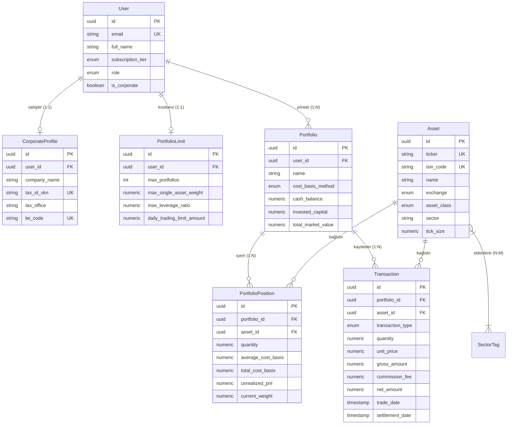

# UTL FİNANS - Kurumsal Finansal Analiz & Portföy Motoru
## Aşama 1: Veritabanı ve Temel Mimari (Database & Core Architecture)

Bu doküman, kurumsal seviyede temel ve teknik analizi birleştiren, yapay zeka ve algoritmik sinyal üretimine hazır **UTL FİNANS** platformunun **Aşama 1: Veritabanı ve Çekirdek Mimari** standartlarını ve teknik spesifikasyonlarını içerir.

---

### 1. Teknoloji Yığını ve Mimari Seçim Gerekçeleri

| Katman | Teknoloji | Seçim Gerekçesi |
| :--- | :--- | :--- |
| **Backend Framework** | **Python (FastAPI)** | FinTech, kantitatif finans (NumPy, pandas, SciPy, statsmodels), makroekonomik projeksiyonlar ve yapay zeka / LLM orkestrasyonu için endüstri standardı. Asenkron (async/await) mimarisi ile yüksek eşzamanlı piyasa veri akışı. |
| **İlişkisel Veritabanı** | **PostgreSQL 16** | Çift taraflı muhasebe (Double-entry ledger), ACID uyumluluğu, `NUMERIC` kesinliği, JSONB esnekliği ve TimescaleDB uzantısı ile finansal zaman serisi desteği. |
| **ORM Katmanı** | **SQLAlchemy 2.0 (Async)** | `asyncpg` sürücüsü ile tam asenkron I/O, tip güvenli deklaratif modeller ve float sızıntılarını engelleyen `SafeFinancialDecimal` tip dönüştürücüsü. |
| **Veri Doğrulama** | **Pydantic v2** | Rust çekirdekli ultra hızlı veri doğrulama, `Decimal` serileştirme ve JSON `float` yuvarlama hatalarına karşı koruma. |
| **Migrasyon & Şema** | **Alembic** | Otomatik şema versiyonlama, geriye dönük migration yönetimi. |
| **Önbellek & Mesaj Kuyruğu**| **Redis 7** | Anlık canlı hisse fiyatları, emir defteri ve piyasa tickleri için in-memory cache. |

---

### 2. Finansal Hassasiyet (Financial Precision) Standartları

Finansal platformlarda standart `float` (IEEE-754 64-bit ikili kayan nokta) kullanımı affedilemez yuvarlama ve bakiye kayma hatalarına yol açar:
$$\text{Örnek: } 0.1 + 0.2 = 0.30000000000000004$$

Bu riski %100 ortadan kaldırmak için sistem genelinde **`decimal.Decimal`** (38 basamak hassasiyet ve Bankacı Yuvarlaması - `ROUND_HALF_EVEN`) standardı benimsenmiştir:

| Veri Alanı | PostgreSQL Tipi | Python Tipi | Hassasiyet / Ölçek | Kullanım Alanı |
| :--- | :--- | :--- | :--- | :--- |
| **Fiyatlar (Prices)** | `NUMERIC(18, 6)` | `Decimal` | 6 Basamak (0.000001) | Hisse fiyatları, mikro-kuruş/sub-tick kotasyonları. |
| **Miktarlar (Quantities)** | `NUMERIC(24, 8)` | `Decimal` | 8 Basamak (0.00000001) | Lot sayıları, kesirli hisseler, bedelsiz bölünme katsayıları. |
| **Parasal Büyüklük (Money)** | `NUMERIC(24, 4)` | `Decimal` | 4 Basamak (0.0001) | Portföy değeri, nakit bakiye, komisyon ve stopaj kesintileri. |
| **Oranlar & Rasyolar (Ratios)**| `NUMERIC(12, 6)` | `Decimal` | 6 Basamak (0.000001) | Varlık ağırlıkları, getiri yüzdeleri, F/K, PD/DD, Sharpe, Volatilite. |

---

### 3. Varlık İlişkileri ve Veritabanı Modeli (ER Diyagramı)



---

### 4. Proje Dizin Yapısı (Enterprise Clean Architecture)

```text
backend/
├── alembic/                      # Veritabanı migrasyon scriptleri
│   ├── versions/
│   └── env.py                    # Asenkron SQLAlchemy migrasyon köprüsü
├── app/
│   ├── core/                     # Çekirdek konfigürasyon & hassasiyet motoru
│   │   ├── config.py             # Pydantic v2 ortam değişkenleri (PostgreSQL, Redis, JWT)
│   │   ├── database.py           # AsyncEngine, sessionmaker ve Base Declarative
│   │   └── precision.py          # SafeFinancialDecimal, kuruş ve Banker's Rounding
│   ├── models/                   # SQLAlchemy 2.0 ORM Varlıkları
│   │   ├── base.py               # UUIDMixin, TimestampMixin
│   │   ├── user.py               # User, CorporateProfile, SubscriptionTier, PortfolioLimit
│   │   ├── asset.py              # Asset, SectorTag, AssetClass, MarketExchange
│   │   └── portfolio.py          # Portfolio, PortfolioPosition, Transaction, WAC
│   ├── schemas/                  # Pydantic v2 Girdi/Çıktı doğrulama şemaları
│   │   ├── user.py
│   │   ├── asset.py
│   │   └── portfolio.py
│   ├── services/                 # İş kuralları & Finansal hesaplama motoru
│   │   └── portfolio_engine.py   # WAC, realizasyon, nakit mutabakat motoru
│   └── main.py                   # FastAPI ASGI uygulama giriş noktası & Health check
├── tests/
│   └── test_financial_precision.py # Float sapması & WAC doğrulama testleri
├── alembic.ini                   # Alembic konfigürasyonu
├── docker-compose.yml            # PostgreSQL 16 + Redis + API servisleri
├── Dockerfile                    # Multi-stage Python 3.12 konteyner tanımı
└── requirements.txt              # Üretim ortamı bağımlılıkları
```

---

### 5. Hızlı Başlangıç (Docker & Local Geliştirme)

#### Adım 1: Konteynerleri Başlatma
```bash
cd backend
docker-compose up -d
```
Bu komut PostgreSQL 16 (`localhost:5432`), Redis 7 (`localhost:6379`) ve FastAPI motorunu (`localhost:8000`) ayağa kaldırır.

#### Adım 2: Veritabanı Migrasyonları
```bash
# İlk migrasyon dosyasını üretme
alembic revision --autogenerate -m "Initial schema: Users, Assets, Portfolios, Transactions"

# Şemayı uygulama
alembic upgrade head
```

#### Adım 3: Swagger / OpenAPI Dokümantasyonu
Tarayıcınızda açın:
* **Interactive API Docs (Swagger):** `http://localhost:8000/docs`
* **Alternative API Docs (ReDoc):** `http://localhost:8000/redoc`
* **Sistem Sağlık Kontrolü:** `http://localhost:8000/health`
