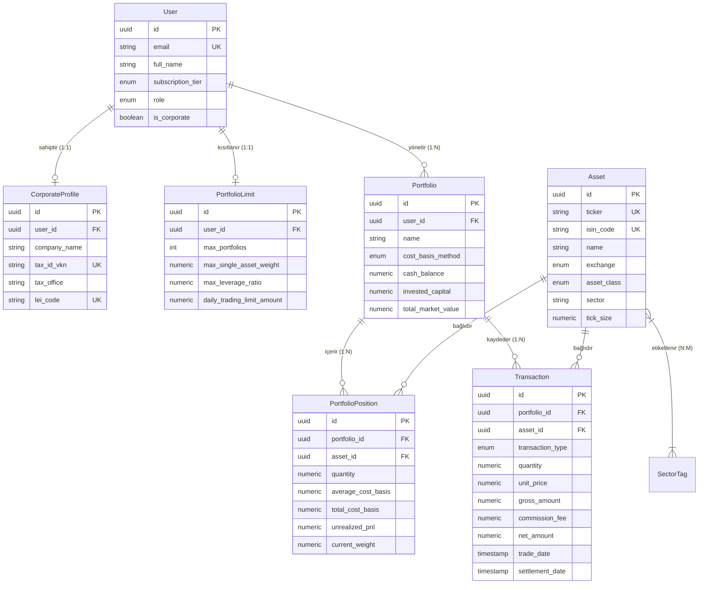

# UTL FİNANS - Kurumsal Finansal Analiz & Portföy Motoru
## Aşama 1: Veritabanı ve Temel Mimari (Database & Core Architecture)

Bu doküman, kurumsal seviyede temel ve teknik analizi birleştiren, yapay zeka ve algoritmik sinyal üretimine hazır **UTL FİNANS** platformunun **Aşama 1: Veritabanı ve Çekirdek Mimari** standartlarını ve teknik spesifikasyonlarını içerir.

---

### 1. Teknoloji Yığını ve Mimari Seçim Gerekçeleri

| Katman | Teknoloji | Seçim Gerekçesi |
| :--- | :--- | :--- |
| **Backend Framework** | **Python (FastAPI)** | FinTech, kantitatif finans (NumPy, pandas, SciPy, statsmodels), makroekonomik projeksiyonlar ve yapay zeka / LLM orkestrasyonu için endüstri standardı. Asenkron (async/await) mimarisi ile yüksek eşzamanlı piyasa veri akışı. |
| **İlişkisel Veritabanı** | **PostgreSQL 16** | Çift taraflı muhasebe (Double-entry ledger), ACID uyumluluğu, `NUMERIC` kesinliği, JSONB esnekliği ve TimescaleDB uzantısı ile finansal zaman serisi desteği. |
| **ORM Katmanı** | **SQLAlchemy 2.0 (Async)** | `asyncpg` sürücüsü ile tam asenkron I/O, tip güvenli deklaratif modeller ve float sızıntılarını engelleyen `SafeFinancialDecimal` tip dönüştürücüsü. |
| **Veri Doğrulama** | **Pydantic v2** | Rust çekirdekli ultra hızlı veri doğrulama, `Decimal` serileştirme ve JSON `float` yuvarlama hatalarına karşı koruma. |
| **Migrasyon & Şema** | **Alembic** | Otomatik şema versiyonlama, geriye dönük migration yönetimi. |
| **Önbellek & Mesaj Kuyruğu**| **Redis 7** | Anlık canlı hisse fiyatları, emir defteri ve piyasa tickleri için in-memory cache. |

---

### 2. Finansal Hassasiyet (Financial Precision) Standartları

Finansal platformlarda standart `float` (IEEE-754 64-bit ikili kayan nokta) kullanımı affedilemez yuvarlama ve bakiye kayma hatalarına yol açar:
$$\text{Örnek: } 0.1 + 0.2 = 0.30000000000000004$$

Bu riski %100 ortadan kaldırmak için sistem genelinde **`decimal.Decimal`** (38 basamak hassasiyet ve Bankacı Yuvarlaması - `ROUND_HALF_EVEN`) standardı benimsenmiştir:

| Veri Alanı | PostgreSQL Tipi | Python Tipi | Hassasiyet / Ölçek | Kullanım Alanı |
| :--- | :--- | :--- | :--- | :--- |
| **Fiyatlar (Prices)** | `NUMERIC(18, 6)` | `Decimal` | 6 Basamak (0.000001) | Hisse fiyatları, mikro-kuruş/sub-tick kotasyonları. |
| **Miktarlar (Quantities)** | `NUMERIC(24, 8)` | `Decimal` | 8 Basamak (0.00000001) | Lot sayıları, kesirli hisseler, bedelsiz bölünme katsayıları. |
| **Parasal Büyüklük (Money)** | `NUMERIC(24, 4)` | `Decimal` | 4 Basamak (0.0001) | Portföy değeri, nakit bakiye, komisyon ve stopaj kesintileri. |
| **Oranlar & Rasyolar (Ratios)**| `NUMERIC(12, 6)` | `Decimal` | 6 Basamak (0.000001) | Varlık ağırlıkları, getiri yüzdeleri, F/K, PD/DD, Sharpe, Volatilite. |

---

### 3. Varlık İlişkileri ve Veritabanı Modeli (ER Diyagramı)



---

### 4. Proje Dizin Yapısı (Enterprise Clean Architecture)

```text
backend/
├── alembic/                      # Veritabanı migrasyon scriptleri
│   ├── versions/
│   └── env.py                    # Asenkron SQLAlchemy migrasyon köprüsü
├── app/
│   ├── core/                     # Çekirdek konfigürasyon & hassasiyet motoru
│   │   ├── config.py             # Pydantic v2 ortam değişkenleri (PostgreSQL, Redis, JWT)
│   │   ├── database.py           # AsyncEngine, sessionmaker ve Base Declarative
│   │   └── precision.py          # SafeFinancialDecimal, kuruş ve Banker's Rounding
│   ├── models/                   # SQLAlchemy 2.0 ORM Varlıkları
│   │   ├── base.py               # UUIDMixin, TimestampMixin
│   │   ├── user.py               # User, CorporateProfile, SubscriptionTier, PortfolioLimit
│   │   ├── asset.py              # Asset, SectorTag, AssetClass, MarketExchange
│   │   └── portfolio.py          # Portfolio, PortfolioPosition, Transaction, WAC
│   ├── schemas/                  # Pydantic v2 Girdi/Çıktı doğrulama şemaları
│   │   ├── user.py
│   │   ├── asset.py
│   │   └── portfolio.py
│   ├── services/                 # İş kuralları & Finansal hesaplama motoru
│   │   └── portfolio_engine.py   # WAC, realizasyon, nakit mutabakat motoru
│   └── main.py                   # FastAPI ASGI uygulama giriş noktası & Health check
├── tests/
│   └── test_financial_precision.py # Float sapması & WAC doğrulama testleri
├── alembic.ini                   # Alembic konfigürasyonu
├── docker-compose.yml            # PostgreSQL 16 + Redis + API servisleri
├── Dockerfile                    # Multi-stage Python 3.12 konteyner tanımı
└── requirements.txt              # Üretim ortamı bağımlılıkları
```

---

### 5. Hızlı Başlangıç (Docker & Local Geliştirme)

#### Adım 1: Konteynerleri Başlatma
```bash
cd backend
docker-compose up -d
```
Bu komut PostgreSQL 16 (`localhost:5432`), Redis 7 (`localhost:6379`) ve FastAPI motorunu (`localhost:8000`) ayağa kaldırır.

#### Adım 2: Veritabanı Migrasyonları
```bash
# İlk migrasyon dosyasını üretme
alembic revision --autogenerate -m "Initial schema: Users, Assets, Portfolios, Transactions"

# Şemayı uygulama
alembic upgrade head
```

#### Adım 3: Swagger / OpenAPI Dokümantasyonu
Tarayıcınızda açın:
* **Interactive API Docs (Swagger):** `http://localhost:8000/docs`
* **Alternative API Docs (ReDoc):** `http://localhost:8000/redoc`
* **Sistem Sağlık Kontrolü:** `http://localhost:8000/health`


---

## Aşama 2: Veri Akışı ve API Entegrasyonları (Data Pipeline & API Integrations)

Aşama 2 kapsamında kurumsal seviyede gerçek zamanlı piyasa veri akışı, KAP bildirimleri ve makroekonomik parametrelerin veri hattı (Data Pipeline) tamamlanmıştır.

### 1. Hata Yönetimi ve Dayanıklılık (Fault Tolerance Core)

Dış API entegrasyonlarında oluşabilecek gecikme, rate limit aşımı ve servis kesintilerini engellemek için üç kurumsal tasarım deseni entegre edilmiştir ([`app/pipeline/resilience.py`](file:///c:/Users/omera/OneDrive/Masaüstü/Finans%20Deneme/backend/app/pipeline/resilience.py)):

* **Circuit Breaker (Devre Kesici):** `CLOSED` (Normal), `OPEN` (Hızlı Hata / Devre Açık) ve `HALF_OPEN` (Canary / Deneme) durum makinesi. Dış sağlayıcı çöktüğünde sistem gereksiz isteklerle kilitlenmez, anında `CircuitBreakerOpenException` fırlatarak platform stabilitesini korur.
* **Token Bucket Rate Limiter:** Saniyede maksimum istek ve burst limitlerini belirleyen asenkron token kovası algoritması.
* **Exponential Backoff with Full Jitter:** Geçici ağ kopmalarında katlanarak artan bekleme süreleri ve "Thundering Herd" (Sürü Psikolojisi) çöküşünü önleyen rastgele gecikme (jitter) enjeksiyonu.

---

### 2. Canlı Piyasa Verisi & WebSocket Dağıtımı ([`app/pipeline/market_data.py`](file:///c:/Users/omera/OneDrive/Masaüstü/Finans%20Deneme/backend/app/pipeline/market_data.py))

* **Çoklu Varlık Desteği:** BIST 30/100 (`THYAO`, `ASELS`, `GARAN`, `TUPRS`, `KCHOL`...), Döviz (`USD/TRY`, `EUR/TRY`, `GBP/TRY`), Emtia (`XAU/TRY` Gram Altın, `BRENT`, `XAG/TRY` Gümüş).
* **WebSocket İstemcisi:** `/api/v1/market/ws` adresi üzerinden istemcilerin diledikleri hisselere (`{"action": "subscribe", "symbols": ["THYAO", "USD/TRY"]}`) veya tüm piyasaya (`["*"]`) abone olabileceği yayın motoru.
* **Veritabanı Snapshot:** Gelen her tick `MarketPriceSnapshot` tablosunda `Decimal` kesinliğiyle güncellenir.

---

### 3. KAP Bildirimleri & Finansal Metin İşleme ([`app/pipeline/news_kap.py`](file:///c:/Users/omera/OneDrive/Masaüstü/Finans%20Deneme/backend/app/pipeline/news_kap.py))

* **Asenkron Arka Plan Görevi (Background Worker):** Belirli aralıklarla KAP ve finansal RSS akışlarını tarayan bağımsız iş parçacığı.
* **Doğal Dil İşleme (Financial NLP):**
  - **Hisse Kodu Çıkarımı:** Başlık veya metindeki `[THYAO]`, `ASELS` veya şirket unvanlarını otomatik tespit eder.
  - **Kategori Sınıflandırma:** Bildirimi `TEMETTU`, `FINANSAL_RAPOR`, `SERMAYE_ARTIRIMI`, `GENEL_KURUL`, `PAY_ALIM_SATIM` olarak etiketler.
  - **Duygu & Fiyat Duyarlılığı Analizi:** Bildirimin piyasa etkisini (-1.00 ile +1.00 puan) ve fiyat duyarlılığını (`is_price_sensitive`) ölçer.

---

### 4. Makroekonomik Göstergeler & TCMB Hattı ([`app/pipeline/macro.py`](file:///c:/Users/omera/OneDrive/Masaüstü/Finans%20Deneme/backend/app/pipeline/macro.py))

* **Zamanlanmış Görev (Scheduled Engine):** TCMB, TÜİK ve Hazine göstergelerini periyodik olarak günceller:
  - **TCMB Politika Faizi:** %50.00
  - **Türkiye 5 Yıllık CDS Primi:** ~264.50 bps
  - **TÜİK Yıllık & Aylık TÜFE Enflasyonu:** %49.38 ve %2.97
  - **Piyasa Katılımcıları 12 Ay TÜFE Beklentisi:** %27.44
  - **2 Yıllık & 10 Yıllık Gösterge Tahvil Faizleri:** %43.15 ve %28.80
* Bu veriler portföy optimizasyonunda risksiz getiri oranı (Risk-Free Rate) ve nakit akımı indirgeme modellerine otomatik girdi sağlar.

---

### 5. API v1 Uç Noktaları Özeti

| Modül | Metot | Endpoint | Açıklama |
| :--- | :--- | :--- | :--- |
| **Market** | `GET` | `/api/v1/market/quotes` | Tüm BIST, Döviz ve Emtia anlık fiyatları |
| **Market** | `GET` | `/api/v1/market/quotes/{symbol}` | Belirli bir enstrümanın fiyat tick detayı |
| **Market** | `WS` | `/api/v1/market/ws` | Gerçek zamanlı WebSocket fiyat beslemesi |
| **News** | `GET` | `/api/v1/news/disclosures` | KAP bildirimleri (hisse, kategori, duygu filtresi) |
| **News** | `GET` | `/api/v1/news/tickers/{ticker}` | İlgili hisseye ait tüm KAP duyuruları |
| **News** | `POST`| `/api/v1/news/sync` | Arka plan KAP tarayıcısını tetikler |
| **Macro** | `GET` | `/api/v1/macro/indicators` | Güncel TCMB faiz, CDS, enflasyon ve tahvil serisi |
| **Macro** | `GET` | `/api/v1/macro/indicators/{key}` | İlgili makro göstergenin geçmiş zaman serisi |
| **Macro** | `POST`| `/api/v1/macro/sync` | Makroekonomik veri eşitlemesini tetikler |
